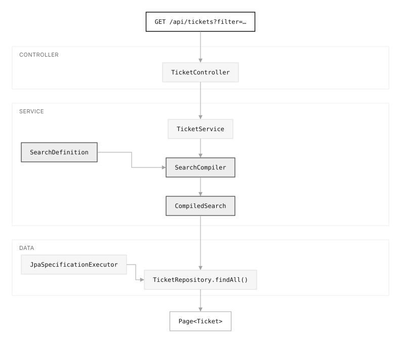

# rsql-jpa-search

[](https://github.com/ggomarighetti/rsql-jpa-search/actions/workflows/verify.yml)
[](https://central.sonatype.com/artifact/io.github.ggomarighetti/rsql-jpa-search-spring-boot-starter)
[](https://javadoc.io/doc/io.github.ggomarighetti/rsql-jpa-search-api)
[](https://github.com/ggomarighetti/rsql-jpa-search/releases)
[](https://scorecard.dev/viewer/?uri=github.com/ggomarighetti/rsql-jpa-search)
[](https://www.bestpractices.dev/projects/13353)
[](https://adoptium.net/)
[](https://spring.io/projects/spring-boot)
[](LICENSE)


`rsql-jpa-search` adds an explicit search contract between incoming RSQL filters
and Spring Data JPA. Clients can combine filters dynamically; your application
decides which fields and operators exist, how values are validated, and how much
each request can ask for.

Declare the contract, compile the request, and pass the resulting
`Specification<T>` and `Pageable` to your repository. The library lives in the
service layer: your application owns authentication, query execution, and HTTP
responses.

[Getting started](#getting-started) · [API reference](docs/API_REFERENCE.md) ·
[Full tutorial (English)](https://ggomarighetti.dev/en/articles/advanced-search-spring-boot-jpa-rsql/) ·
[Tutorial completo (español)](https://ggomarighetti.dev/es/articulos/busqueda-avanzada-spring-boot-jpa-rsql/)

## Why a Search Contract?

Search endpoints often start with a few parameters and accumulate another
filter, sort option, and conditional for every new requirement. RSQL lets the
client express those combinations in one filter parameter. A search contract
keeps that flexibility within the API you intend to expose:

- **Public field names:** map `team` to `team.name` without exposing the entity
  structure or private properties such as `ownerId`.
- **Explicit capabilities:** allow filtering and sorting per field, choose its
  operators, and convert and validate values before querying.
- **Bounded requests:** limit filter complexity, list sizes, joins, pagination,
  and sorting.
- **Mandatory conditions:** combine application-owned rules, such as ticket
  ownership or tenant isolation, with the client filter using `AND`.

The library contributes three pieces to an otherwise ordinary Spring Data flow:

| Type | Responsibility |
|---|---|
| `SearchDefinition<T>` | Declares the reusable contract for one search use case |
| `SearchCompiler` | Enforces the contract and adds application-owned business rules |
| `CompiledSearch<T>` | Carries the resulting `Specification<T>` and validated `Pageable` |



Under the hood, [nstdio/rsql-parser](https://github.com/nstdio/rsql-parser)
parses the expression,
[perplexhub/rsql-jpa-specification](https://github.com/perplexhub/rsql-jpa-specification)
provides the default JPA translation, and Hibernate Validator evaluates declared
constraints. `rsql-jpa-search` coordinates those pieces around your contract.

## What is RSQL?

RSQL gives the frontend and backend a shared language for filters. The frontend
builds an expression from the user's selections and sends it in a URL query
parameter. The backend parses it into a tree of conditions, an abstract syntax
tree (AST), before compiling the query. For example:

```text
status==OPEN;(team=in=(support,billing),tag==urgent)
```

This selects tickets whose status is `OPEN` and that either belong to the
support or billing team or carry the urgent tag. A semicolon (`;`) means `AND`,
a comma (`,`) means `OR`, and parentheses group conditions. Without parentheses,
`AND` takes precedence over `OR`.



Each comparison has a public selector, an operator, and one or more values:
`team`, `=in=`, and `(support,billing)`. The configured backend also supports
operators such as `==`, `!=`, `=ge=`, `=le=`, `=between=`, and `=ilike=`. Which
ones a client may use depends on the field's definition; see the
[filtering reference](docs/API_REFERENCE.md#filtering).

## Getting Started

### 1. Add the starter

The starter targets Java 17+ and Spring Boot 4.x. It includes the API, compiler,
JPA validation, and default Perplexhub backend, and auto-configures
`SearchDefinition.Factory` and `SearchCompiler` for injection.

With Maven:

```xml
<dependency>
  <groupId>io.github.ggomarighetti</groupId>
  <artifactId>rsql-jpa-search-spring-boot-starter</artifactId>
  <version>2.0.1</version>
</dependency>
```

Or with Gradle Kotlin DSL:

```kotlin
implementation("io.github.ggomarighetti:rsql-jpa-search-spring-boot-starter:2.0.1")
```

Version 2.0.1 uses Perplexhub `rsql-jpa` and `rsql-common` 7.0.3. Applications
without Spring Boot can assemble the [individual modules](docs/ARCHITECTURE.md#modules).

### 2. Declare the search contract

Consider a support application where each user searches their own tickets.
Assume a JPA `Ticket` entity with `UUID id`, `String title`, `TicketStatus status`,
`Instant createdAt`, a `Team team` relation with a `name` property, a `Tag`
collection named `tags` with a `name` property, and a private `UUID ownerId`.
`TicketStatus` includes `OPEN`.

Register a reusable definition as a Spring bean in a `@Configuration` class.
The factory applies the application's path-depth policy during construction.
The definition belongs to a search use case: the same entity can have a narrow
contract for a user's inbox and a broader one for a supervisor's view.

```java
import io.github.ggomarighetti.rsqljpasearch.definition.SearchDefinition;
import java.time.Instant;
import org.hibernate.validator.cfg.defs.PatternDef;
import org.hibernate.validator.cfg.defs.SizeDef;
import org.springframework.context.annotation.Bean;

import static io.github.ggomarighetti.rsqljpasearch.rsql.operator.RsqlOperators.BETWEEN;
import static io.github.ggomarighetti.rsqljpasearch.rsql.operator.RsqlOperators.EQUAL;
import static io.github.ggomarighetti.rsqljpasearch.rsql.operator.RsqlOperators.IGNORE_CASE_LIKE;
import static io.github.ggomarighetti.rsqljpasearch.rsql.operator.RsqlOperators.IN;

@Bean
SearchDefinition<Ticket> ticketSearch(SearchDefinition.Factory definitions) {
    return definitions.builder()
            .entity(Ticket.class)
            .fields(fields -> {
                fields.add("title", String.class)
                        .filterable(f -> f.allow(IGNORE_CASE_LIKE));
                fields.add("status", TicketStatus.class)
                        .filterable(f -> f.allow(EQUAL, IN));
                fields.add("createdAt", Instant.class)
                        .filterable(f -> f.allow(BETWEEN))
                        .sortable();
                fields.add("team", String.class)
                        .path("team.name")
                        .filterable(f -> f.allow(EQUAL, IN));
                fields.add("tag", String.class)
                        .path("tags.name")
                        .filterable(f -> f.allow(EQUAL, op -> op.each(value -> value
                                .rule(new PatternDef().regexp("[a-z0-9-]+")))));
            })
            .query(q -> q
                    .rule(new SizeDef().min(3).max(80))
                    .specification(TicketSpecifications::matchesText))
            .paging()
            .limits(limits -> limits
                    .filter(f -> f.maxComparisons(10).maxInValues(20))
                    .paging(p -> p.maxSize(50)))
            .build();
}
```

Fields start with filtering and sorting disabled. `.filterable(f -> ...)`
allows only the operators you declare; `.filterable()` uses a type-aware default
profile. Null checks always require an explicit opt-in. `.sortable()` enables
both sort directions, and `.paging()` enables paged requests.

Public names are independent of persistence paths. Here, `team` maps to
`team.name`, while `ownerId` has no public selector and cannot be filtered or
sorted by the client.



The `tag` selector traverses a to-many relation. Accepted filters on that path
make the query distinct to avoid duplicate tickets; sorting through to-many
paths is rejected. Values are converted to their declared types before
validation, so malformed enums, UUIDs, or dates fail during compilation.

### 3. Add business rules and free-text search

Business rules are conditions that must hold regardless of the client's filter.
Keep request-dependent rules, such as ticket ownership, outside the reusable
`SearchDefinition`: write them as ordinary Spring Data `Specification`s and
pass them to the compiler with the authenticated user's context.

The optional `query` input follows a separate path from RSQL. Its specification
factory is registered in the definition, and the library validates the text
before calling it. The application supplies both pieces:

```java
import java.util.Locale;
import java.util.UUID;
import org.springframework.data.jpa.domain.Specification;

final class TicketSpecifications {
    static Specification<Ticket> ownedBy(UUID userId) {
        return (root, query, cb) -> cb.equal(root.get("ownerId"), userId);
    }

    static Specification<Ticket> matchesText(String text) {
        String literal = text.toLowerCase(Locale.ROOT)
                .replace("\\", "\\\\").replace("%", "\\%").replace("_", "\\_");
        return (root, query, cb) ->
                cb.like(cb.lower(root.get("title")), "%" + literal + "%", '\\');
    }
}
```

This example uses a case-insensitive substring match with literal input. For
larger datasets, the same hook can use a database full-text function or an
indexed search strategy. The library validates the text; the application owns
the matching semantics.

### 4. Compile and execute

The repository needs Spring Data's `JpaSpecificationExecutor`:

```java
public interface TicketRepository
        extends JpaRepository<Ticket, UUID>, JpaSpecificationExecutor<Ticket> {
}
```

Inject `SearchCompiler`, `SearchDefinition<Ticket>` (the `ticketSearch` bean),
and `TicketRepository` into your service. Compilation evaluates the request
against the definition and adds the business rules. If the request meets the
contract, the service passes the resulting specification and pageable to the
repository; otherwise, compilation throws an exception:

```java
import io.github.ggomarighetti.rsqljpasearch.compile.CompiledSearch;

public Page<Ticket> search(UUID userId, String filter, String query, Pageable pageable) {
    CompiledSearch<Ticket> compiled = searchCompiler.compile(
            filter, query, pageable, ticketSearch,
            TicketSpecifications.ownedBy(userId));

    return ticketRepository.findAll(compiled.specification(), compiled.pageable());
}
```

Take `userId` from the authenticated context. The controller passes the optional
`filter` and `query` strings and the Spring Data `Pageable` to this method. For
example, an open-ticket search can use these parameters (shown before URL
encoding):

```text
GET /api/tickets?filter=status==OPEN;team==support&page=0&size=20&sort=createdAt,desc
```

The compiler combines the RSQL filter, optional query specification, and
`ownedBy(userId)` with `AND`. Ownership still applies when the client uses `OR`
inside its filter or omits the filter entirely.



## Validation and Limits

A rejected request stops compilation before your service calls the repository.
With the definition above:

| Input | Why it is rejected |
|---|---|
| `ownerId==...` | The selector is not public |
| `status=ilike=O*` | The field only allows equality and membership |
| `tag==Urgent!` | The value fails the declared format rule |
| `size=500` | The definition limits page size to 50 |
| `sort=team,asc` | Sorting is only enabled for `createdAt` |

Map request validation and protection exceptions to your API's error response,
typically HTTP `400` through `@RestControllerAdvice`. They provide stable codes
and structured details. A `SearchDefinitionValidationException` instead signals
an application configuration error. See the [error handling guide](docs/ERROR_HANDLING.md)
for the exception types and handler examples.

Global protection is configured under `rsql.jpa.search`; `.limits(...)` overrides
selected policy values for a definition. Tune filter length, tree depth,
comparison counts, joins, offsets, and sort orders for your indexes and traffic.
See [configuration](docs/CONFIGURATION.md) for the defaults and override semantics.

## Documentation

- [API reference](docs/API_REFERENCE.md): definitions, operators, validation,
  paging, sorting, query text, and slice compilation.
- [Configuration](docs/CONFIGURATION.md): global properties and local policies.
- [Error handling](docs/ERROR_HANDLING.md): exceptions, error codes, and HTTP handlers.
- [Customization](docs/CUSTOMIZATION.md): custom operators, conversion, and backends.
- [Architecture](docs/ARCHITECTURE.md): modules, runtime flow, and trust boundaries.
- [All guides](docs/README.md): the documentation index, including security and release guides.

## Complete Tutorial

The blog walks through the ticket example from the entity and controller to
definitions, compilation, business rules, errors, and configuration:

- [Advanced Search in Spring Boot with JPA and RSQL](https://ggomarighetti.dev/en/articles/advanced-search-spring-boot-jpa-rsql/)
- [Búsqueda avanzada en Spring Boot con JPA y RSQL](https://ggomarighetti.dev/es/articulos/busqueda-avanzada-spring-boot-jpa-rsql/)
  — Spanish

The diagrams above are local SVG exports from the article. Their
[source and export notes](docs/images/README.md) are included in the repository.

## Security

If you think you found a vulnerability, please report it privately through
[GitHub Security Advisories](https://github.com/ggomarighetti/rsql-jpa-search/security/advisories/new)
instead of opening a public issue. For ordinary bugs, documentation problems,
or feature requests, use GitHub issues.

The supported-version policy and disclosure process are documented in
[SECURITY.md](SECURITY.md).

## Contributing

Issues, bug reports, documentation improvements, and pull requests are welcome.

The development workflow, review policy, pull request standards, Conventional
Commit rules, and required DCO sign-off are documented in
[CONTRIBUTING.md](CONTRIBUTING.md).

## License

Released under the [MIT License](LICENSE).
